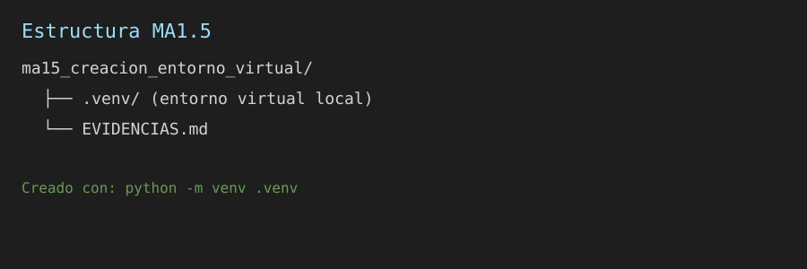
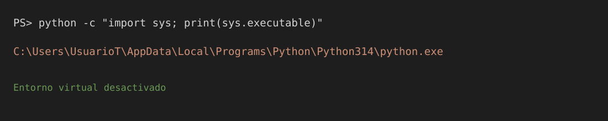
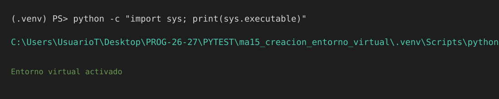
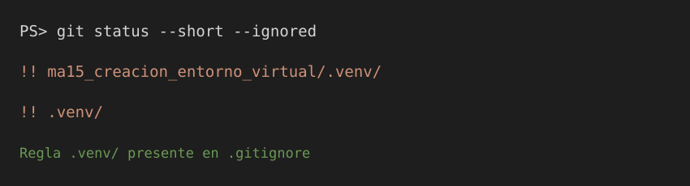

# MA1.5 — Creación de un entorno virtual

## 1. Estructura final del proyecto

## 2. Intérprete con el entorno desactivado

## 3. Intérprete con el entorno activado

## 4. Comprobación de .gitignore

