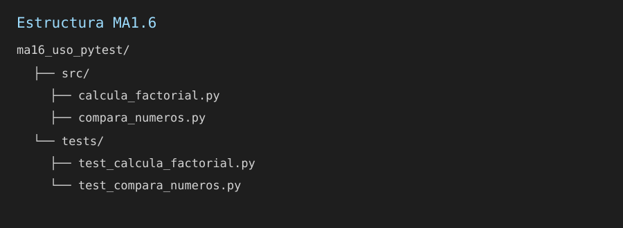
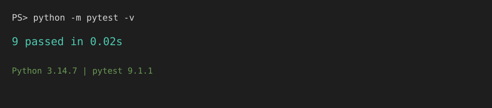
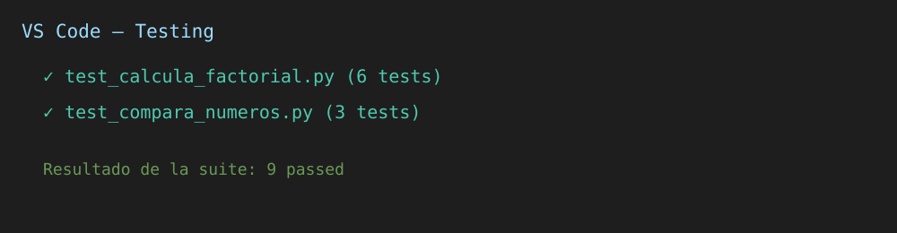
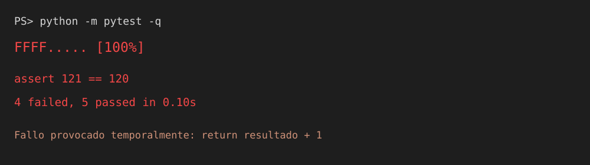
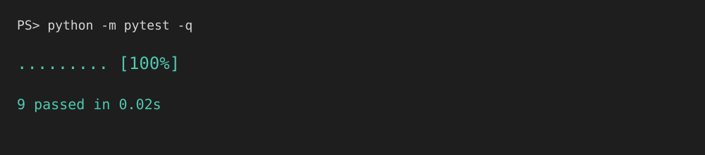

# MA1.6 — Uso de pytest

## 1. Estructura final del proyecto

## 2. Ejecución de pytest desde el terminal

## 3. Ejecución desde Testing de VS Code

## 4. Detección de un error

## 5. Corrección del error

